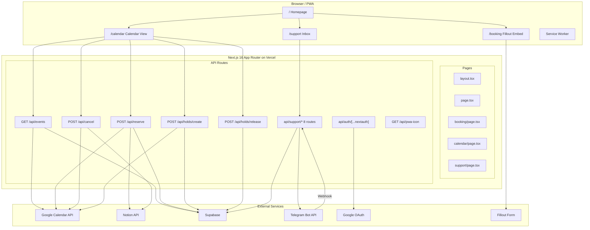
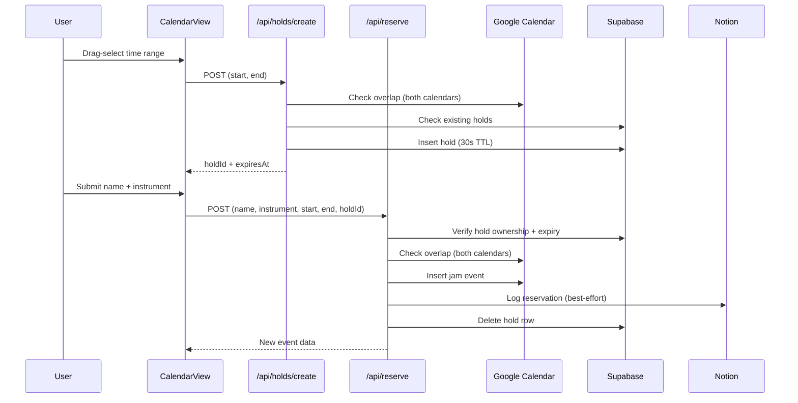
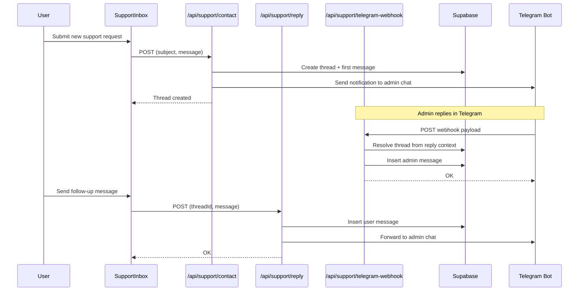
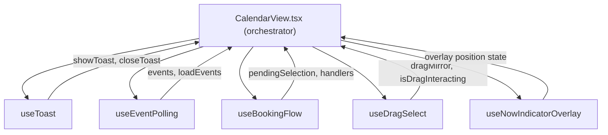

# CS Practice Room App — Architecture & Codebase Overview

This document describes how the project is structured and what each major part does. It is intended as a map for maintenance, onboarding, and debugging (for example, Vercel deploy issues versus a working local setup).

The jam reservation system in this repo started as a copy of the original Practice Room Jam Scheduler. Its architecture, integrations, and behavior notes are intentionally retained here so the broader practice-room portal can continue to reuse that working foundation.

---

## How we work together (project owner context)

Sam is **not an experienced developer**. When helping with this repo, assistants should:

- **Explain in plain language** what a change or command does before or right after doing it.
- **Prefer small steps** and confirm understanding rather than assuming familiarity with Next.js, Vercel, Supabase, or OAuth.
- **Ask follow-up questions** when something is ambiguous (for example, which environment is failing, or what you see on screen).
- **Call out risks** (secrets in chat, breaking production, deleting calendar data) before destructive or irreversible actions.

---

## Product intent (from project context)

- **Public calendar**: Anyone can see practice-room availability: practice bookings (from one Google Calendar) and jam reservations (from another).
- **Jam reservations**: Signed-in Google users can drag-select a time range, optionally get a short **temporary hold** in Supabase, then confirm with name and instrument. The server creates a Google Calendar event on the jam calendar and logs a row in **Notion**.
- **Cancellation**: Jam creators can cancel their own events; an **admin email** (env) can cancel any jam. Practice bookers can cancel their own practice from the calendar only when their linked WWU email is an attendee and their name matches the title segment after the hyphen.
- **PWA**: Install prompts, web app manifest, and a service worker cache an app shell for offline-friendly loading (not a full offline calendar sync).
- **Support inbox**: Signed-in users can submit support requests and exchange messages with staff. Messages sync bidirectionally with a Telegram admin chat.
- **Booking form**: An embedded Fillout form for longer practice-room bookings (separate from jam reservations).

---

## System architecture diagram



---

## Data flow diagrams

### Jam reservation flow



### Support message flow



---

## Tech stack

| Layer | Choice | Version |
| --- | --- | --- |
| Framework | **Next.js** (App Router) | 16.2.2 |
| UI library | **React** | 19.2.4 |
| Styling | **Tailwind CSS** v4 (`@import "tailwindcss"` in `app/globals.css`) | ^4 |
| Calendar UI | **FullCalendar** (`@fullcalendar/react`, time grid + interaction) | ^6.1.20 |
| End-user auth | **NextAuth v5** (`next-auth@5.0.0-beta.30`) with **Google** provider, JWT sessions | 5.0.0-beta.30 |
| Google Calendar (server) | **googleapis** with a **service account** JWT (Calendar API scope) | ^171.4.0 |
| Temporary holds | **Supabase** (`@supabase/supabase-js`), service role, table `reservation_holds` | ^2.101.1 |
| Logging | **Notion** (`@notionhq/client` + REST for data source query) | ^5.16.0 |
| Support / messaging | **Supabase** tables (`support_threads`, `support_messages`) + **Telegram Bot API** | — |
| Booking form | **Fillout** (external embedded iframe) | — |
| Testing | **Playwright** | ^1.59.1 |
| Hosting | **Vercel** (Hobby plan) | — |
| Bundler (dev) | **Webpack** (`next dev --webpack`) — intentional for FullCalendar compat in dev | — |

`package.json` runs the dev server with **`next dev --webpack`** (Webpack for development). Re-verify calendar behavior before switching dev bundlers.

---

## Dependency inventory

### Runtime dependencies

| Package | Purpose |
| --- | --- |
| `next` | App framework — App Router, API routes, server components, metadata |
| `react` / `react-dom` | UI rendering |
| `@fullcalendar/core` | Calendar engine (event model, date math, plugin system) |
| `@fullcalendar/react` | React bindings for FullCalendar |
| `@fullcalendar/timegrid` | Time grid view plugin (week/day views with time slots) |
| `@fullcalendar/interaction` | User interaction plugin (selection, drag, click) |
| `next-auth` | Authentication framework — Google OAuth, JWT sessions |
| `googleapis` | Google API client — Calendar API v3 for reading/writing events |
| `@notionhq/client` | Notion SDK — creating/querying pages for reservation logging |
| `@supabase/supabase-js` | Supabase client — temporary holds table and support inbox tables |

### Dev dependencies

| Package | Purpose |
| --- | --- |
| `tailwindcss` / `@tailwindcss/postcss` | Utility-first CSS framework, v4 PostCSS integration |
| `typescript` | Type checking |
| `eslint` / `eslint-config-next` | Linting with Next.js recommended rules |
| `@playwright/test` | End-to-end browser testing |
| `@types/node` / `@types/react` / `@types/react-dom` | TypeScript type definitions |

---

## Local secrets: where they live

Next.js automatically loads environment variables from a file named **`.env.local`** in the **project root** (same folder as `package.json`). That is the usual place for secrets when developing on your machine.

- **Never commit** `.env.local` or any file containing real keys. It should stay in `.gitignore`.

**Security habit:** Treat anything that looks like a password, token, or private key as **compromised if it was pasted into a chat, screenshot, or ticket**. Rotate it in the relevant console (Google Cloud, Notion, Supabase, Vercel) and update your `.env.local` and Vercel env vars.

---

## Environment variables (full list)

Values are **not** documented here—only **names** and what they are for. See `.env.example` for the full checklist.

### Google Calendar (service account — server)

Used by `lib/google.ts` so the **server** can read/write calendars without each user granting Calendar access.

| Variable | Purpose |
| --- | --- |
| `GOOGLE_CLIENT_EMAIL` | Service account email |
| `GOOGLE_PRIVATE_KEY` | Service account private key (stored with `\n` for newlines) |
| `GOOGLE_PROJECT_ID` | Google Cloud project id |

### Calendars and admin

| Variable | Purpose |
| --- | --- |
| `PRACTICE_CALENDAR_ID` | Google Calendar id for practice events (read-only in the app UI) |
| `JAM_CALENDAR_ID` | Google Calendar id for jam reservations (create/delete/list) |
| `ROOM_TIME_ZONE` | IANA time zone for new events (code default: `America/Los_Angeles`) |
| `ADMIN_EMAIL` | Legacy single-admin email that may cancel any jam and release others' holds |
| `ADMIN_EMAILS` | Comma-separated Google emails granted admin role (cancel any event, full support access) |

### Notion

| Variable | Purpose |
| --- | --- |
| `NOTION_TOKEN` | Integration token |
| `NOTION_DATA_SOURCE_ID` | Data source id for jam reservation logging |
| `NOTION_FILLOUT_MASTER_DATA_SOURCE_ID` | Data source id for Fillout Form Master Database (practice cancel → **Session Status** via **Custom Event ID**) |
| `NOTION_PEOPLE_DB_ID` | Database ID for the people directory (user profile lookup) |
| `NOTION_PROFILE_LOG_DB_ID` | Database ID for the profile-creation audit log |
| `NOTION_WEBHOOK_VERIFICATION_TOKEN` | Secret for `X-Notion-Signature` on `POST /api/webhooks/notion` (subscription verify + `page.properties_updated`) |
| `NOTION_WEBHOOK_CALENDAR_DEBUG` | Optional: set to `1` to log parent ids and parsed jam **Status** for webhook troubleshooting |

Jam and Fillout master databases should include a **Text** property **`CSPR Cancel origin`**. The app sets it to `calendar_app` when cancelling from the calendar UI first so the jam webhook skips a redundant Google delete.

**Notion → Calendar cancel (jams + practice):** `NOTION_DATA_SOURCE_ID` must match a `data_source_id` or `database_id` on the page’s `parent`. Jam **Status** is read whether Notion stores it as **`select`** or **`status`**. When a practice page is marked **Cancelled** in Notion (and not stamped by the app), the webhook parses the **Custom Event ID** to find and delete the corresponding practice Google Calendar event. `NOTION_FILLOUT_MASTER_DATA_SOURCE_ID` must also match the page parent for this branch to activate.

### Supabase (profiles, temporary holds + support)

| Variable | Purpose |
| --- | --- |
| `SUPABASE_URL` | Project URL |
| `SUPABASE_SERVICE_ROLE_KEY` | Service role key (server-only; full access) |
| `ENABLE_TEMP_HOLDS` | Set to `true` to enable hold create/list/release |

### Sign-in with Google (NextAuth / Auth.js — end users)

| Variable | Purpose |
| --- | --- |
| `AUTH_SECRET` | Secret used to encrypt/sign session tokens |
| `AUTH_GOOGLE_ID` | OAuth 2.0 Client ID from Google Cloud |
| `AUTH_GOOGLE_SECRET` | OAuth 2.0 Client secret |

### Deployment URL

| Variable | Purpose |
| --- | --- |
| `AUTH_URL` | Full site URL (e.g. `https://your-app.vercel.app`). Important for OAuth callbacks. |

### Fillout + Telegram

| Variable | Purpose |
| --- | --- |
| `NEXT_PUBLIC_FILLOUT_URL` | Public URL for the embedded Fillout booking form |
| `NEXT_PUBLIC_TELEGRAM_CONTACT_URL` | Public link to admin Telegram profile |
| `NEXT_PUBLIC_TELEGRAM_GROUP_URL` | Public link to CS Practice Room Telegram group |
| `TELEGRAM_BOT_TOKEN` | Telegram bot token for support inbox |
| `TELEGRAM_SUPPORT_ADMIN_CHAT_ID` | Telegram chat ID where support messages are forwarded |
| `TELEGRAM_WEBHOOK_SECRET` | Shared secret to verify incoming webhook requests |

---

## Repository layout — complete file map

```
cs-practice-room-app/
├── app/                           # Next.js App Router
│   ├── layout.tsx                 # Root layout: dark theme, AuthProvider, SiteHeader, SW, InstallPrompt
│   ├── page.tsx                   # Homepage: navigation cards, contact form, Telegram links
│   ├── globals.css                # Tailwind v4 entry + FullCalendar dark-theme overrides
│   ├── manifest.ts                # PWA Web App Manifest
│   ├── icon.tsx                   # Next.js metadata: 192px favicon via createPwaIcon
│   ├── apple-icon.tsx             # Next.js metadata: 180px Apple touch icon via createPwaIcon
│   ├── booking/
│   │   └── page.tsx               # Fillout iframe embed for practice-room booking
│   ├── calendar/
│   │   └── page.tsx               # CalendarView wrapper (practice + jam grid)
│   ├── support/
│   │   └── page.tsx               # SupportInbox wrapper for support threads
│   └── api/
│       ├── auth/[...nextauth]/
│       │   └── route.ts           # NextAuth GET/POST handlers
│       ├── events/
│       │   └── route.ts           # GET: merge practice + jam calendars + optional holds
│       ├── reserve/
│       │   └── route.ts           # POST: validate, overlap-check, create Google Calendar event, log to Notion
│       ├── cancel/
│       │   └── route.ts           # POST: authorize owner/admin, delete Google event, update Notion
│       ├── webhooks/
│       │   └── notion/
│       │       └── route.ts       # POST: Notion webhooks — profiles + Notion Cancelled → Google delete
│       ├── holds/
│       │   ├── create/route.ts    # POST: overlap-check, insert Supabase hold (30s TTL)
│       │   └── release/route.ts   # POST: authorize owner/admin, delete Supabase hold
│       ├── profile/
│       │   └── setup/route.ts    # POST: first-time account setup (validate WWU email, Notion lookup, Supabase insert)
│       ├── pwa-icon/
│       │   └── route.tsx          # GET: Edge runtime, generates PWA icon via ImageResponse
│       └── support/
│           ├── contact/route.ts   # POST: create new support thread + first message, notify Telegram
│           ├── threads/route.ts   # GET: list all threads for the signed-in user
│           ├── thread/route.ts    # GET: single thread with all messages
│           ├── reply/route.ts     # POST: user sends follow-up message, forwards to Telegram
│           ├── unread/route.ts    # GET: check if user has unread support messages
│           ├── mark-read/route.ts # POST: mark thread as read for the user
│           ├── delete/route.ts    # POST: delete a thread and all its messages
│           └── telegram-webhook/
│               └── route.ts       # POST: receive Telegram webhook, route replies/close commands
│
├── components/                    # React client components
│   ├── AccountSetupModal.tsx      # First-time sign-in: collects WWU email, creates Supabase profile
│   ├── AuthButton.tsx             # Sign in/out button with loading/signed-in/signed-out states
│   ├── AuthProvider.tsx           # NextAuth SessionProvider wrapper + AccountSetupModal mount
│   ├── CalendarView.tsx           # Calendar orchestration: FullCalendar + hooks + modals + overlays
│   ├── ConfirmModal.tsx           # Generic confirm/cancel dialog
│   ├── ContactSupportForm.tsx     # Homepage contact form (creates support thread)
│   ├── EventDetailsModal.tsx      # Event detail popup: practice vs jam info, cancel button
│   ├── InstallPrompt.tsx          # PWA install prompt (Chromium beforeinstallprompt + iOS hint)
│   ├── ReserveModal.tsx           # Booking form: name + instrument, hold countdown, mode states
│   ├── ServiceWorkerRegistration.tsx # Registers /sw.js in production
│   ├── SiteHeader.tsx             # Global header: brand, navigation links, auth button
│   ├── SupportInbox.tsx           # Support thread list + conversation view + message composer
│   ├── SupportNavLink.tsx         # Nav link with unread badge indicator
│   └── Toast.tsx                  # Fixed bottom-right toast notification
│
├── hooks/                         # Custom React hooks
│   ├── useBookingFlow.ts          # Hold lifecycle, reserve/cancel actions, orphan cleanup
│   ├── useDragSelect.ts           # Pointer + touch drag-select on FullCalendar time grid
│   ├── useEventPolling.ts         # Event fetching with 30s polling, focus/visibility refetch
│   ├── useNowIndicatorOverlay.ts  # Custom "now" time indicator positioned over calendar
│   └── useToast.ts                # Toast state management with auto-dismiss
│
├── lib/                           # Shared modules (server + client)
│   ├── admin.ts                   # Admin-role helpers (ADMIN_EMAILS env var parsing)
│   ├── calendar-helpers.ts        # Date clamping, overlap detection, time range formatting
│   ├── calendar-events.ts         # Event description cleanup, attendee normalization, cancel ownership rules
│   ├── formatting.ts              # Shared date/time formatting utilities
│   ├── google.ts                  # Google service account JWT auth + Calendar API client singleton
│   ├── google-calendar-webhook-delete.ts # Idempotent jam Calendar delete for Notion webhook (404-safe)
│   ├── hold-helpers.ts            # Optimistic hold events, sessionStorage persistence, hold ID utils
│   ├── notion.ts                  # Notion client singleton + reservation create/cancel helpers
│   ├── notion-calendar-webhook.ts # Jam Notion **Cancelled** → delete Google event
│   ├── notion-sync-constants.ts   # **CSPR Cancel origin** property name + `calendar_app` value
│   ├── practice-custom-event-id.ts # UTC **Custom Event ID** string for practice ↔ Notion row match
│   ├── pwaIcon.tsx                # createPwaIcon: JSX-based ImageResponse for PWA icons
│   ├── profile-helpers.ts         # Shared Supabase profile lookup by Google email
│   ├── siteConfig.ts              # Centralized app metadata + public URLs (Fillout, Telegram)
│   ├── supabase.ts                # Supabase admin client singleton
│   ├── support.ts                 # Support thread ID parsing, reply/close command parsing
│   ├── timeGridDragSelect.ts      # Low-level drag math: column detection, snapping, range merging, blockers
│   └── types.ts                   # Shared TypeScript types (events, holds, support rows, UI state)
│
├── public/
│   └── sw.js                      # Service worker: cache-first shell, network-first navigation
│
├── e2e/
│   └── home.spec.ts               # Playwright smoke test
│
├── docs/                          # Documentation
│   ├── ARCHITECTURE.md            # This file
│   ├── change-log.md              # Consolidated project history (old jam app + this repo)
│   ├── error-log.md               # Error history and prevention notes
│   ├── BUILD_PHASES.md            # Original build plan for the portal fork
│   ├── BROWSER_VERIFICATION.md    # Browser testing guide (Playwright + MCP)
│   └── README.md                  # Documentation index
│
├── types/
│   └── next-auth.d.ts            # Session/JWT type augmentation (profileComplete flag)
├── auth.ts                        # NextAuth v5 configuration: Google provider, JWT, profile callbacks
├── next.config.ts                 # Next.js config (currently default/empty)
├── tsconfig.json                  # Strict TypeScript, @/* path alias, Next plugin
├── postcss.config.mjs             # Tailwind v4 via @tailwindcss/postcss
├── eslint.config.mjs              # ESLint with next/core-web-vitals + TypeScript
├── playwright.config.ts           # Playwright: Chromium, baseURL localhost:3000, webServer auto-start
├── package.json                   # Dependencies, scripts, project metadata
├── .env.example                   # Environment variable checklist (no values)
├── AGENTS.md                      # Next.js agent rules (read docs before writing code)
└── CLAUDE.md                      # Points to AGENTS.md
```

Path alias: `@/*` → project root (`tsconfig.json`).

---

## Authentication

### `auth.ts`

- **NextAuth** with the **Google** provider only.
- **JWT** session strategy.
- **`trustHost: true`** (important behind proxies like Vercel; pair with correct `AUTH_URL` / deployment URL).
- **`jwt` callback**: On sign-in and session updates, checks Supabase `profiles` table for a row matching the user's Google email. Sets `token.profileComplete` accordingly. Also checks `ADMIN_EMAILS` env var to set `token.isAdmin`.
- **`session` callback**: Exposes `profileComplete` and `isAdmin` on the session object for client-side gating.

### `app/api/auth/[...nextauth]/route.ts`

- Re-exports **`GET`** and **`POST`** from NextAuth **`handlers`**.

### First-time account setup

- **`components/AccountSetupModal.tsx`**: Full-screen blurred overlay shown when `session.profileComplete === false`. Collects WWU email (validated as `First.Last@wallawalla.edu`). Dismissing signs the user out.
- **`app/api/profile/setup/route.ts`**: `POST` — validates email format, queries Notion people DB for a match, inserts a row into Supabase `profiles`, and logs the event to a Notion audit database (fire-and-forget).
- **`types/next-auth.d.ts`**: Augments the `Session` and `JWT` types with `profileComplete?: boolean`.

### `components/AuthProvider.tsx`

- Client wrapper: **`SessionProvider`** from `next-auth/react`.
- Mounts **`AccountSetupModal`** globally so it appears over any page when profile setup is incomplete.

### `components/AuthButton.tsx`

- Loading / signed-out / signed-in states.
- **`signIn("google")`** and **`signOut({ callbackUrl: "/" })`**.
- Shows the signed-in user's email.
- When the profile is complete: **edit** (WWU email) and **refresh** (re-sync from Notion), powered by **`hooks/useProfileSync.ts`**.
- **Profile sync behavior**: `POST /api/profile/sync` runs on mount and every 60 seconds while signed in with a complete profile, updating Supabase from the Notion people database. **Background** sync does **not** call NextAuth **`session.update()`** unless **`bookingAccess`** would change (same rule as `auth.ts`: linked Notion page ↔ `notion_page_id` on the profile). That avoids a session refetch and broad `useSession()` re-renders on every tick, which previously caused visible full-page flicker. **Manual** refresh still calls **`session.update()`** after a successful sync so JWT-backed UI (e.g. booking access) updates immediately.

---

## Hooks architecture

The original `CalendarView.tsx` was 1,445 lines. It was decomposed into five focused hooks that the 344-line orchestrator (`CalendarView.tsx`) wires together:



### `useToast`
Manages toast notification state (open/close, message, type) with 3.5s auto-dismiss timer.

### `useEventPolling`
Fetches events from `GET /api/events`. Re-fetches on auth status change, every 30 seconds when tab is visible and no pending selection, and on window focus/visibility change (with a 5-second cooldown).

### `useBookingFlow`
Manages the full booking lifecycle:
- **Hold creation**: `createHoldOrFallback` → POST to `/api/holds/create`, transitions through `securing` → `hold` → `fallback` modes
- **Stale request handling**: Incremented `holdRequestIdRef` ensures only the latest hold response is applied; stale holds are released automatically
- **Orphan cleanup**: On mount, reads `sessionStorage` for unreleased holds from previous sessions and releases them; on `pagehide`, sends a `keepalive` release request
- **Reserve/cancel**: Submits to `/api/reserve` or `/api/cancel` with optimistic UI updates

### `useDragSelect`
Custom pointer + touch drag-select system that replaces FullCalendar's built-in selection:
- **Mouse/pen**: Immediate activation on `pointerdown`; pointer capture for smooth tracking
- **Touch**: Long-press (220ms) arms drag mode; movement >10px before arming cancels the gesture (allows normal scrolling)
- **Mirror rendering**: `requestAnimationFrame`-driven overlay showing the selected time range with time labels
- **Selection completion**: Validates against blockers, past-day checks, minimum bookable start; creates an optimistic hold event and triggers `createHoldOrFallback`
- **Navigation gestures** (mobile): Horizontal swipe (>50px) navigates prev/next day; double-tap navigates to today

### `useNowIndicatorOverlay`
Positions a custom "current time" indicator over the FullCalendar grid:
- Measures the native `.fc-timegrid-now-indicator-line` position
- Renders a thin hairline across all columns (week view) and a thick segment on today's column with an arrow
- Re-measures on resize, visibility change, and every 30 seconds

---

## Support system architecture

### Overview

The support system provides a bidirectional messaging channel between app users and the room admin:
- **In-app**: Users see a threaded inbox at `/support` and can submit new requests from the homepage contact form
- **Telegram**: Admin receives notifications in a designated Telegram chat and can reply/close threads directly from Telegram

### Supabase tables

**`support_threads`**

| Column | Type | Purpose |
| --- | --- | --- |
| `id` | UUID (PK) | Thread identifier |
| `user_email` | text | Thread owner's email |
| `user_name` | text | Thread owner's display name |
| `status` | text | `open` or `closed` |
| `unread_for_user` | boolean | Whether admin has sent unread messages |
| `telegram_chat_id` | text | Telegram chat where the notification was sent |
| `telegram_root_message_id` | bigint | Telegram message ID for native reply mapping |
| `telegram_topic_id` | bigint | Telegram forum topic ID for topic-based threading |
| `created_at` / `updated_at` | timestamptz | Timestamps |

**`support_messages`**

| Column | Type | Purpose |
| --- | --- | --- |
| `id` | UUID (PK) | Message identifier |
| `thread_id` | UUID (FK) | References `support_threads.id` |
| `author_type` | text | `user` or `admin` |
| `body` | text | Message content |
| `source` | text | `app` or `telegram` |
| `telegram_update_id` | text (unique) | Deduplication key for Telegram webhooks |
| `created_at` | timestamptz | Timestamp |

### Telegram admin commands

- **Forum topic**: Each new support thread creates a dedicated topic in the admin supergroup; admins can type directly in the topic without commands
- **Native reply**: Reply to a bot notification message in Telegram → the webhook resolves the thread from `telegram_root_message_id` and inserts an admin message
- **`/reply SR-<thread-id> <text>`**: Explicit reply command when native reply context is unavailable
- **`/close`** (as a reply): Closes the thread, notifies the user, and closes the Telegram topic
- **`/close SR-<thread-id>`**: Explicit close command (also closes the topic)

### API routes (8 endpoints under `/api/support/`)

| Route | Method | Purpose |
| --- | --- | --- |
| `/contact` | POST | Create new thread + first message, send Telegram notification |
| `/threads` | GET | List all threads for the signed-in user (with latest message summary) |
| `/thread` | GET | Single thread with all messages |
| `/reply` | POST | User sends follow-up message, forwards to Telegram |
| `/unread` | GET | Check if user has unread messages (used by `SupportNavLink` badge) |
| `/mark-read` | POST | Mark thread as read when user views it |
| `/delete` | POST | Delete thread and all messages |
| `/telegram-webhook` | POST | Receive Telegram webhook, route to reply/close handlers |

### `lib/support.ts` — command parsing

Provides utility functions for Telegram message routing:
- `toSupportThreadKey(threadId)` → `SR-<id>` prefix
- `extractSupportThreadIdFromText(text)` → extracts thread ID from any text containing `SR-<id>`
- `parseReplyCommand(text)` → parses `/reply SR-<id> <body>` format
- `parseCloseCommand(text)` → parses `/close` or `/close SR-<id>` format

---

## PWA architecture

### Service worker (`public/sw.js`)

- **Cache name**: `jam-scheduler-shell-v1`
- **Install**: Precaches `/`, `/manifest.webmanifest`, PWA icon URLs
- **Activate**: Deletes old caches, `clients.claim()`
- **Fetch strategy**:
  - Skips non-GET, foreign origins, and `/api/*` (APIs always go to network)
  - **Navigation**: Network-first with cache fallback; updates cache on success
  - **Other same-origin GET**: Cache-first, then network (updates cache on miss)

### Manifest (`app/manifest.ts`)

Exports a `MetadataRoute.Manifest` with app name, icons pointing at `/api/pwa-icon` (192 and 512 sizes), `standalone` display mode.

### Icon generation

`lib/pwaIcon.tsx` renders a dark rounded square with "Room" / "Jam" typography using Next.js `ImageResponse` (from `next/og`). Used by:
- `app/icon.tsx` — 192px favicon
- `app/apple-icon.tsx` — 180px Apple touch icon
- `app/api/pwa-icon/route.tsx` — Edge runtime, dynamic size via query param

### Install prompt (`components/InstallPrompt.tsx`)

- Listens for Chromium's `beforeinstallprompt` event
- Shows iOS-specific "Add to Home Screen" hint via Safari user-agent detection
- Dismiss hides for the rest of the local day (persisted in `localStorage`)
- Auto-hides after 15 seconds per app session
- Uses `useSyncExternalStore` for hydration-safe standalone detection

---

## CSS architecture

### `app/globals.css` structure

The CSS file serves as both the Tailwind v4 entry point and a comprehensive FullCalendar dark-theme override:

1. **Tailwind setup**: `@import "tailwindcss"` + `@theme inline` for CSS custom properties
2. **Dark theme variables**: `--background: #030303`, `--foreground: #ffffff`, `color-scheme: dark`
3. **FullCalendar base**: Resets borders, border-radius, scrolling behavior for the dark theme
4. **Time axis panel**: Fixed 132px width (104px on mobile), dark background, consistent label styling
5. **Day column headers**: Dark backgrounds, past-day dimming
6. **Day columns (body)**: Dark grid cells, pseudo-element column separators, past-day dimming
7. **Time slots**: 48px height, subtle grid lines
8. **Selection & events**: Transparent highlight (replaced by custom drag mirror), dashed mirror styling, rounded event blocks with dark shadows
9. **Past event styling**: Dimmed + desaturated events that have ended
10. **Custom event content**: Flex layout for time + title display within event blocks
11. **Pending hold events**: Dashed border, glass-like backdrop blur
12. **Now indicator**: Hidden native indicator (replaced by custom overlay)
13. **Mobile overrides**: Narrower time axis (104px), smaller padding

**No separate `tailwind.config.*`** — Tailwind v4 is configured entirely through PostCSS and CSS directives.

---

## Core UI: calendar and flows

### `components/CalendarView.tsx` (client)

Central orchestration:

- **`useSession`** for auth status.
- **Mobile vs desktop**: `window.innerWidth < 768` toggles FullCalendar **`timeGridDay`** vs **`timeGridWeek`** (component remounts via `key`).
- **Loads events** from **`GET /api/events`** (no cache); reloads when auth status changes, every 30s when the tab is visible (and no pending selection), and on window focus / visibility change (same guard).
- **Selection rules**: Custom drag-select replaces FullCalendar's built-in selection; max drag duration capped; **`clampSelectionRange`** enforces 30 minutes–6 hours.
- **Signed-in only** for selecting a slot; otherwise a toast asks to sign in.
- After select: **`createHoldOrFallback`** → `POST /api/holds/create`. On success, enters hold mode with `holdId` and server-normalized times; on 409 or failure, falls back to fallback mode.
- Uses a request id (`holdRequestIdRef`) to ignore stale hold responses and release orphan holds.
- **`ReserveModal`**: Collects first name + instrument, shows hold countdown / securing / fallback messaging.
- **`handleReserve`**: `POST /api/reserve` with `holdId` when present.
- **Event click**: Opens **`EventDetailsModal`** with title, date range, cleaned Google description text, and owner-gated cancel controls; hold events show an info toast instead.
- **Cancel path**: **`ConfirmModal`** then `POST /api/cancel` with `googleEventId` and `eventType`.
- **Keyboard shortcuts** (desktop): Arrow keys navigate prev/next week, `T` goes to today, `Escape` closes modals.
- **Touch gestures** (mobile): Swipe left/right navigates days, double-tap goes to today.

---

## Modals and chrome

| File | Role |
| --- | --- |
| `components/ReserveModal.tsx` | Form: first name, instrument select (Drums / Piano / Other). Modes: securing, hold (countdown to `onExpire`), fallback. Disables submit while securing. |
| `components/EventDetailsModal.tsx` | Shows practice vs jam, title, time range, cleaned description text; cancel button only when the current user owns the event and it has not ended. |
| `components/ConfirmModal.tsx` | Generic confirm/cancel dialog (used for cancel confirmation). |
| `components/Toast.tsx` | Fixed bottom-right toast (success / error / info), auto-dismiss ~3.5s from parent. |
| `components/InstallPrompt.tsx` | `beforeinstallprompt` for Chromium install; iOS Safari hint; hides when standalone or dismissed. |
| `components/ServiceWorkerRegistration.tsx` | In **production** only, registers `/sw.js` on `window` `load`. |

---

## API routes

### `GET app/api/events/route.ts`

- Optional session: reads `session.user.email` for permission hints.
- Loads **practice** and **jam** calendars via `getCalendarClient()` for a window: 7 days ago → 30 days ahead.
- Loads the current user's Supabase profile when available so practice ownership can be evaluated against linked WWU email and display name.
- Maps Google events to a unified JSON shape: `eventType` `practice` | `jam`, colors, cleaned `description`, normalized `attendees`, and `canCancel`.
- Jam `canCancel`: owner email from `extendedProperties.private.ownerEmail` vs current user vs `ADMIN_EMAIL`, or `isAdmin` (from `ADMIN_EMAILS` env var).
- Practice `canCancel`: linked WWU email must appear in attendees and the booker name in the title (after the hyphen) must match the current user, or `isAdmin`.
- If `ENABLE_TEMP_HOLDS === "true"`, merges pending Supabase holds as `eventType: "hold"` with dashed styling class. Supabase errors are logged; events still return without holds.

### `POST app/api/reserve/route.ts`

- **Requires** signed-in user; uses `ownerEmail` / `ownerName` from session.
- Validates body: `name`, `instrument`, `start`, `end`, optional `holdId`.
- Duration 30 min–6 h; parses ISO datetimes.
- If holds enabled and `holdId` present: loads hold from Supabase, checks owner, status `pending`, not expired, and times match (±1s). On verification failure, logs and continues (overlap check still runs).
- Lists overlapping window on **both** calendars; `hasOverlap` rejects if any event overlaps.
- `calendar.events.insert` on `JAM_CALENDAR_ID` with summary `"Name - Instrument"` and `extendedProperties.private`: `ownerEmail`, `ownerName`. Time zone from `ROOM_TIME_ZONE`.
- `createJamReservationInNotion` — failures are logged only (reservation still succeeds).
- Deletes hold row after success if `holdId` was used.

### `POST app/api/cancel/route.ts`

- Requires sign-in.
- Accepts `googleEventId` plus `eventType`.
- Jam cancellation: fetches event from jam calendar, reads `ownerEmail` from private extended properties, allows owner/admin, deletes the event, then best-effort updates Notion.
- Practice cancellation: fetches event from the practice calendar, loads the current user's linked WWU profile, requires attendee email + title-name ownership match, then deletes the event, then best-effort updates Notion (Fillout master DB) by **Custom Event ID** built from UTC start/end (`lib/practice-custom-event-id.ts`).
- Both paths reject ended events before deletion.

### `POST app/api/holds/create/route.ts`

- Requires sign-in; validates slot duration.
- Checks Google Calendar overlap on both calendars.
- If `ENABLE_TEMP_HOLDS !== "true"` → 503.
- Queries Supabase for overlapping pending holds; if any → 409.
- Inserts row: `owner_email`, `owner_name`, `start_at`, `end_at`, `expires_at` = now + 30 seconds, `status: "pending"`.

### `POST app/api/holds/release/route.ts`

- Requires sign-in.
- If holds disabled → success no-op.
- Loads hold by `holdId`; allows delete if user is owner or admin.

### `GET app/api/pwa-icon/route.tsx`

- `runtime = "edge"`.
- Query `size`: 512 or default 192.
- Returns `ImageResponse` from `createPwaIcon`.

---

## Library modules (`lib/`)

### `lib/google.ts`
Builds JWT auth from `GOOGLE_CLIENT_EMAIL`, `GOOGLE_PRIVATE_KEY` (newline fix `replace(/\\n/g, "\n")`), `GOOGLE_PROJECT_ID`. Scope: `https://www.googleapis.com/auth/calendar`. Lazy singleton `getCalendarClient()`.

### `lib/admin.ts`
Admin-role helpers. `getAdminEmails()` parses the `ADMIN_EMAILS` env var into a `Set<string>`; `isAdminEmail(email)` checks membership. Used in `auth.ts` JWT callback, profile setup, cancel routes, and support routes.

### `lib/supabase.ts`
`getSupabaseAdmin()`: `SUPABASE_URL` + `SUPABASE_SERVICE_ROLE_KEY`, no session persistence (server-only). Lazy singleton. The service role key bypasses RLS, so all tables are accessible even though RLS is enabled with no permissive policies (see [Row-Level Security](#row-level-security-rls)).

### `lib/notion.ts`
`getNotionClient()` / headers with `NOTION_TOKEN` and fixed API version. `createJamReservationInNotion`: `pages.create` with parent `data_source_id`. `markJamReservationCancelledInNotion` / `markPracticeBookingCancelledInNotionByCustomId`: set Cancelled + **CSPR Cancel origin** when the cancel originated in the app (practice: calendar → Notion only; Notion does not delete practice Google events). `processNotionCalendarCancellationWebhook` ([`lib/notion-calendar-webhook.ts`](lib/notion-calendar-webhook.ts)): jam only — Notion **Cancelled** → Google `events.delete`. `findNotionPersonByWWUEmail`: queries the people database by "Walla Walla Email" for profile setup. `logProfileCreationToNotion`: writes an audit row to the profile-creation log database (fire-and-forget).

### `lib/pwaIcon.tsx`
`ImageResponse` JSX: dark rounded square, "Room" / "Jam" typography.

### `lib/siteConfig.ts`
Centralized app metadata: name, description, public URLs for Fillout, Telegram contact, and Telegram group. Reads from `NEXT_PUBLIC_*` env vars with fallback defaults.

### `lib/types.ts`
Shared TypeScript types: `GoogleApiEvent`, `CalendarEventAttendee`, `HoldRow`, `ApiCalendarEvent`, `CalendarEvent`, `PendingSelection`, `ToastState`, `DragMirrorState`, `ProfileRow` (includes `is_admin`), `SupportThreadRow`, `SupportMessageRow`.

### `lib/calendar-helpers.ts`
Date clamping, busy-block overlap detection, time range formatting, ISO timestamp utilities.

### `lib/calendar-events.ts`
Shared event metadata helpers: strips the Fillout footer from Google descriptions, normalizes attendees, derives the practice booker name from the title, and centralizes practice/jam cancel authorization checks.

### `lib/formatting.ts`
Shared date/time formatting (date range display with arrow, elapsed time, etc.).

### `lib/hold-helpers.ts`
Optimistic hold event creation (`makeOptimisticHoldEvent`), `sessionStorage` persistence for hold IDs across page loads, strip/filter utilities.

### `lib/profile-helpers.ts`
Shared Supabase profile lookup used by event APIs to resolve the signed-in user's linked WWU email and display name from their Google account email.

### `lib/timeGridDragSelect.ts`
Low-level drag-select math:
- `findBodyColumnIndex`: Hit-test mouse position against FullCalendar column elements
- `clientYToSnappedMinutes`: Convert pixel Y to snapped 15-minute intervals
- `dayDateForColumn` / `minutesOnDayToDate`: Column index → calendar date conversion
- `mergeSelectionRange`: Merge anchor + pointer into a valid range, clipping against busy blocks
- `clipSelectionEnd` / `clipSelectionStart`: Prevent selection from overlapping existing events
- `applyMinBookableStartToRange`: Ensure selection doesn't start in the past
- `mirrorBoundsForRange`: Calculate pixel bounds for the drag mirror overlay
- `selectionIsBookable`: Final validation (30 min–6 h, not past)

### `lib/support.ts`
Thread ID formatting (`SR-<id>` prefix), Telegram command parsing (`/reply`, `/close`), thread ID extraction from message text.

---

## Supabase schema (inferred from code)

### Row-Level Security (RLS)

All public tables have **RLS enabled** with **no permissive policies**. The `anon` and `authenticated` Postgres roles have **zero grants** on any table. This means:

- The Supabase REST API (anon key) cannot read, write, or delete any data.
- The app is unaffected because it exclusively uses the **service role key** via `getSupabaseAdmin()` in server-side API routes — the service role bypasses RLS entirely.
- If the app ever introduces a client-side Supabase client (using the anon key), explicit RLS policies would need to be created for the tables it accesses.

This was applied via the `enable_rls_on_all_tables` migration (2026-04-11).

### Table `reservation_holds`

| Column | Type | Usage |
| --- | --- | --- |
| `id` | UUID | Returned as `holdId` |
| `owner_email` | text | Lowercased comparison to session |
| `owner_name` | text | Optional display metadata |
| `start_at` / `end_at` | timestamptz | ISO timestamps |
| `expires_at` | timestamptz | Hold expiry (30 seconds after create) |
| `status` | text | e.g. `pending` |

### Table `support_threads`

See [Support system architecture](#support-system-architecture) above.

### Table `support_messages`

See [Support system architecture](#support-system-architecture) above.

---

## Configuration files

| File | Role |
| --- | --- |
| `next.config.ts` | Default/empty Next config (placeholder for future options) |
| `tsconfig.json` | Strict TypeScript, `@/*` paths, Next plugin |
| `postcss.config.mjs` | Tailwind v4 via `@tailwindcss/postcss` |
| `eslint.config.mjs` | ESLint with Next preset (core-web-vitals + TypeScript) |
| `playwright.config.ts` | Chromium, `baseURL` localhost:3000, `webServer` auto-starts `npm run dev` |

---

## Request / data flow (summary)

1. **Browse**: `GET /api/events` merges Google (practice + jam) + optional Supabase holds; UI assigns colors, cleaned descriptions, and owner-aware `canCancel` flags.
2. **Select slot** (authenticated): `POST /api/holds/create` → optional 30-second hold, or fallback UI if disabled/fails.
3. **Confirm**: `POST /api/reserve` → verify hold if any → overlap check → Google insert → Notion insert (best-effort) → delete hold.
4. **Cancel**: `POST /api/cancel` → authorize by event type → Google delete → Notion status update for jams (Google Event ID) and practice (**Custom Event ID**, best-effort), stamping **CSPR Cancel origin** = `calendar_app`. **Notion → Google (jams only):** `POST /api/webhooks/notion` on `page.properties_updated` deletes the jam Calendar event when **Status** is **Cancelled** and origin is not `calendar_app`.
5. **Support**: User submits via `/api/support/contact` → Supabase + Telegram. Admin replies via Telegram webhook or `/api/support/reply`.

**Source of truth for "what is booked"** is **Google Calendar** (two calendars). **Notion** is a **log/audit** mirror. **Supabase** is **ephemeral coordination** for holds and **persistent storage** for support threads.

---

## Deploy / localhost divergence (observation only)

Localhost "works" when all env vars and Google/Notion/Supabase credentials match that environment. Vercel builds can fail for reasons unrelated to business logic (for example: missing env vars at build time, Edge vs Node runtime constraints, Next.js 16 breaking changes per `AGENTS.md`). Use Vercel build logs and compare env configuration to the variable tables above when debugging.

**Checklist for Vercel:** For each name in the tables above that the app needs at runtime, add the same variable in the Vercel project settings (Production and Preview if you use previews). OAuth redirect URIs in Google Cloud must include your production URL.

---

## Related documentation

- **[change-log.md](./change-log.md)**: Full project history from the pre-Cursor ChatGPT thread through every commit in this repo. Git commit log with attribution, anti-regression table.
- **[error-log.md](./error-log.md)**: Historical and ongoing error documentation with root causes and prevention notes.
- **[BUILD_PHASES.md](./BUILD_PHASES.md)**: Original build plan for the portal fork from the standalone jam scheduler.
- **[BROWSER_VERIFICATION.md](./BROWSER_VERIFICATION.md)**: Browser testing guide for Playwright and Cursor MCP.
