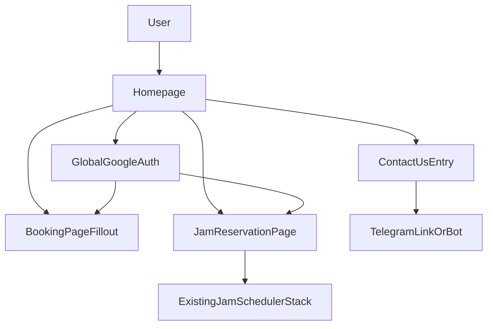

# CS Practice Room App Build Phases

This file keeps the original phased build plan in the repository so it stays easy to reference as the project evolves.

## Recommendation

Create a new repo and new deployment by copying the current project at `<old-repo>`, while leaving the current Jam Reservation repo and deployment untouched.

This should be treated as a product fork, not a quick feature branch. The safest default is:

- Duplicate the current repo into a new folder named `cs-practice-room-app`
- Keep the current app live as-is
- Connect the copy to a brand-new GitHub repository
- Deploy the new app as a separate Vercel project

## Existing Context To Preserve

Carry these files into the new repo intact at the start:

- `<old-repo>/docs/ARCHITECTURE.md`
- `<old-repo>/AGENTS.md`
- `<old-repo>/.cursor/SETTINGS.md`
- `<old-repo>/.cursor/rules/collaboration.mdc`

Also preserve the current app foundation that already helps here:

- `<old-repo>/app/layout.tsx` already wraps the whole app in auth, install prompt, and service-worker plumbing
- `<old-repo>/auth.ts` already gives Google OAuth
- `<old-repo>/app/page.tsx` is currently a single-route app and will need to become a true homepage
- `<old-repo>/components/CalendarView.tsx` is the core jam scheduler page that can be moved under a dedicated route

## Feasibility Findings

### What is straightforward

- Homepage plus navigation: straightforward in the current Next.js app
- Fillout booking page: straightforward via Fillout embed code or iframe-style embed
- Global Google sign-in: straightforward because the current app already uses app-wide auth wrappers
- Separate GitHub repo plus separate Vercel project: straightforward and stays within free/hobby usage for a small app

### What should not be promised yet

- A true embedded Telegram group chat UI inside your site is likely not available in the way originally described. Telegram officially supports login widgets, embedded public posts, and discussion widgets tied to public channel posts, but not a full website-hosted Telegram group chat clone for normal external sites.
- Sending Telegram messages as the signed-in user from your website should be treated as not feasible for Phase 1. Telegram bots send as bots, not as the user, and the normal website widgets do not turn your website into a full Telegram client.

### Practical Telegram fallback

For a free/hobby-friendly plan, the realistic options are:

- Homepage `Contact Us` button that opens your Telegram account or a Telegram bot
- Optional Phase 2 contact form or chat-like UI on your site that forwards messages to you through a bot, with replies handled by Telegram and/or email-style follow-up
- Group chat handled as a link-out to the Telegram group, or at most a limited public embed if Telegram’s public widgets fit your exact use case

## Proposed App Shape

## Phase 0: Fork the app safely

Goal: create the new project without risking the current one.

Work:

- Copy the current repo into a new folder `cs-practice-room-app`
- Preserve docs, Cursor rules, and design language from the existing project
- Create a new GitHub repository for `cs-practice-room-app`
- Create a separate deployment target so the current Jam Reservation app keeps running unchanged

Important decision:

- Keep the old Jam Reservation app online during the whole build; do not repoint its domain or repo during early phases

## Phase 1: Turn the single-page scheduler into a portal app

Goal: make the new app feel like the practice room home base.

Routes to add:

- `/` homepage with welcome text, helpful links, and clear navigation cards/buttons
- `/booking` page for the embedded Fillout booking form
- `/calendar` page for the current calendar (practice + jam) experience

Implementation direction:

- Move the current scheduler out of the root page and place it behind a dedicated jam route
- Reuse the current global layout and auth wrapper rather than adding separate auth systems per page
- Keep the existing visual style first, then refine branding after the information architecture works

Phase 1 deliverable:

- A clean homepage that acts as the front door to the practice room app
- A working embedded booking page
- A working jam reservation page carried over from the current app

## Phase 2: Make auth truly app-wide

Goal: sign in once from the homepage and reuse that identity where it helps.

Phase 2 approach:

- Keep Google sign-in as the primary global OAuth layer first, because it already exists and is tied to jam reservations
- Show sign-in state on the homepage header and nav
- Use the signed-in user’s identity to:
  - access the jam scheduler page
  - optionally prefill name and email fields where possible
  - support future account-linked features

Important note:

- Do not couple Phase 1 success to Telegram account linking
- If Telegram account linking is still desired later, treat it as a separate feature with separate UX and security review

## Phase 3: Improve the Fillout booking page

Goal: embed the current CS Practice Room booking workflow without building a second scheduling backend.

Work:

- Embed the Fillout form on `/booking`
- Check whether Fillout supports passing signed-in user info through embed parameters for prefill
- Add a short explanation above the form so users know when to use booking vs jam reservation

Risk to verify:

- Confirm your Fillout plan/settings allow the public embed behavior you want

## Phase 4: Add simple contact options

Goal: give users an easy path to reach you without overbuilding chat.

Recommended first version:

- Put a `Contact Us` card or button on the homepage
- Open your Telegram profile, username link, or a Telegram bot conversation

Optional richer version later:

- A small on-site message-us form or chat-like UI that sends the message to your Telegram bot
- Keep replies simple rather than trying to mirror full Telegram chat in the browser

## Phase 5: Revisit Telegram community features

Goal: evaluate whether any Telegram-based community view belongs inside the app.

Recommended default:

- Link out to the public CS Practice Room Telegram group

Only pursue in-page Telegram work if later research confirms it cleanly supports your public group scenario. Right now, this should be treated as a research spike, not a committed build item.

## Accounts And Keys You Will Need

### Definitely needed for the new project

- GitHub: a new repository for `cs-practice-room-app`
- Vercel: a new project on the Hobby plan for separate deployment
- Google OAuth client: recommended to create a new web OAuth client for the new deployed app URL and localhost callback URLs
- `AUTH_SECRET`: a new random secret for the new deployment

### Likely reusable from the current app

These can probably be reused initially if the new app’s jam page should operate on the same real data:

- existing Google Calendar service account credentials
- existing calendar IDs
- existing Supabase project and table for temporary holds
- existing Notion integration and data source

This reuse is reasonable because the jam scheduler page is staying the same in the new portal app. Later, if you want cleaner separation, those integrations can be split.

### Only needed if Telegram grows beyond links

- Telegram account: for your own contact presence
- Telegram bot via `@BotFather`: needed if you want website-to-Telegram contact flows or Telegram login features
- Linked domain for Telegram Login Widget: only if Telegram login or account linking is added later

### Probably not needed

- No paid auth provider
- No paid database just to launch the portal app
- No custom backend just to embed Fillout and preserve the jam scheduler

## Step-By-Step Account Setup Checklist

1. Create the new GitHub repo `cs-practice-room-app`
2. Create a new Vercel project connected to that repo
3. Generate a new `AUTH_SECRET` for the new app
4. Create a new Google OAuth web client for the new app
5. Add localhost and Vercel callback URLs for that OAuth client
6. Copy over the required environment variables from the current app to the new Vercel project
7. Decide whether the new app should initially reuse the same Google Calendar, Supabase, and Notion resources as the old one
8. Only if needed later, create a Telegram bot and link it to the site domain

## Recommended Build Order

1. Create the copied repo and new GitHub/Vercel project
2. Verify the copied app still runs unchanged in the new repo
3. Split the app into homepage, booking page, and jam page
4. Move global sign-in affordances onto the homepage and header
5. Embed Fillout and test the jam page still works
6. Add simple contact links
7. Reassess whether Telegram deserves a dedicated Phase 2 or Phase 3 implementation

## Success Criteria For The First Release

- The current Jam Reservation app still exists unchanged
- `cs-practice-room-app` is a separate repo and deployment
- The new homepage is the front door for the practice room
- Users can navigate to the Fillout booking form page and the jam scheduler page
- Google sign-in remains available globally and still supports jam reservations
- Telegram is handled in a simple low-risk way rather than blocking launch

## Biggest Risks To Watch

- Accidentally changing the existing production app instead of the copy
- Reusing auth callbacks or env vars incorrectly across two deployments
- Overcommitting to Telegram features that Telegram’s web widgets do not actually support
- Letting the homepage and portal refactor break the existing jam reservation behavior

